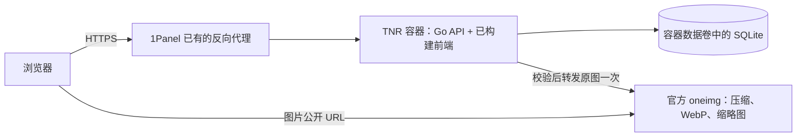

# 架构与接口

## 部署结构

反向代理是 1Panel 现有的网站服务，不要求为本项目额外部署服务。Compose 仅包含 `tnr` 与 `oneimg`。SQLite 随各自应用运行，没有额外数据库容器。

前端是 React 19、Vite、Tailwind CSS 4 与 shadcn/ui Radix 组件。Node 用于构建和开发；生产由一个 Go 进程提供 API、静态资源和 SPA 路由，打开 `/admin` 无需另一个前端服务。静态 JS/CSS 由构建阶段预压缩，使用带哈希的文件名和长期缓存；入口 HTML 要求重新验证。

Go 使用标准库 `net/http`；SQLite 使用 WAL 与单写连接，适合公益项目单实例部署。TNR 不进行图片解码后重编码，也不依赖图片编码库。官方 oneimg 负责全部图片压缩、格式转换和缩略图生成。没有 Redis、消息队列或常驻 Node 服务。

`Cat.neuteredAt` 为选填的 `YYYY-MM-DD` 绝育日期，仅「已绝育」时允许非空，不保存时区或时刻。创建接口使用同名表单字段，后台编辑使用 JSON 字段。数据库启动时检查 `cats.neutered_at`，缺少则新增 `TEXT NOT NULL DEFAULT ''`；重复启动不重复修改表，已有档案和相册保持原样。详情展示日期，后台修改与清空沿用档案审计快照。

## 图片链路

1. 志愿者提交 `multipart/form-data` 到 `POST /api/cats`，附带全部资料与 `photos` 文件。
2. 验证身份、字段、照片数量、真实图片格式、每张大小、总大小与像素数。支持 JPEG/PNG/WebP，拒绝 SVG、GIF、HEIC 和其他格式；HEIC 需要先从设备导出 JPEG。
3. 最多允许两个相册请求同时进行，满额立即返回 429。每个相册内部顺序转发照片；TNR 只读取图片头验证尺寸，不为转码分配整幅位图。完整解码和处理由图床负责。
4. 图片字节保持原样转发；TNR 不旋转、不压缩、不转换格式。oneimg 需开启「图片压缩」「保存 WebP」「缩略图」。核验版本的缩略图最大 300×300、质量 80；主图尺寸和压缩策略取决于图床实现，当前源码没有固定 1600px 缩放。EXIF 方向和元数据处理也由图床决定，TNR 不保证消除原图中的位置信息。
5. 为新猫分配固定的随机相册编号；按 `NTR-名字-相册编号-照片随机编号.jpg/png/webp` 命名，扩展名和 MIME 取自实际输入格式。上传时使用官方 `POST /api/upload/images`，表单文件字段是 `images[]`，可带 `folder_id`。图床转码后自行生成最终 WebP 扩展名。
6. 每张照片只上传一次，对应一条 oneimg 图片记录；保存响应中的 `id`、`url`、`thumbnail_url`、宽高。官方上传接口的本地存储可返回 `/uploads/…` 相对路径，TNR 使用显式配置的 `ONEIMG_PUBLIC_ORIGIN` 补全主图和缩略图 URL；绝对 HTTP(S) 地址及其签名查询参数保持不变。绝不使用容器内部上传地址 `ONEIMG_BASE_URL` 补全公开链接。缺少公开域名时返回明确的配置提示；拒绝非 HTTP(S)、带用户信息或协议相对地址。严格检查 `code`、`success`、图片 ID、公开 URL、`mime_type=image/webp`、解析后独立的缩略图，以及配置过的目录 ID 是否确实生效。缺少缩略图或未转 WebP 时明确报错，不以原图冒充缩略图；已上传文件保留并记入审计。检查依据为官方响应，不会额外下载图片逐字节核验编码。
7. 全部上传成功后，在 SQLite 事务内同时保存猫咪档案与创建审计记录。响应失败时界面不显示保存成功。
8. 总览每页 24 只，原生 `loading="lazy"` 与 `decoding="async"`，固定图片区域防止布局跳动，使用图床返回的 `thumbnail_url`。详情组件按需载入，只在打开相册时请求图床返回的主图 `url`。

列表返回的是单页完整档案，相册没有固定的照片数量上限；每次请求仍受 50 MiB 文件总量、单图 10 MiB / 3200 万像素及处理超时约束，后台可分批追加。大图片字节由 oneimg 直接提供，不经过 TNR 转发。生产不依赖 Unsplash 或其他公共图库，只有明确开启的演示页面使用外部样图。

## 官方 oneimg 的归档限制

核验版本为上游提交 `0f5a2d4ee07ba2615739ffc9974aaccddb44ee72`（2026-11-09）。

- 上传 Token 可通过 `folder_id` 上传到同一用户已有的文件夹。
- Token 的路由白名单不包含创建/列举文件夹、创建标签和删除图片。
- 文件夹模型没有父目录字段，文件夹名称禁止 `/` 和 `\`，并存在每账户 200 个文件夹的上限。
- 上传表单的 `tags` 仅关联已有标签，不会创建新标签。
- 文件夹是图床管理中的逻辑分类，不代表底层对象存储实际存在同名磁盘目录。

因此采用一个预建 `NTR` 文件夹和可搜索的唯一文件名前缀；不开启自动创建文件夹、动态标签、直接读写图床数据库、图床 Cookie 接管或远程删除接口。

## 账号与审计

| 身份 | 权限 |
| --- | --- |
| 访客 | 浏览、搜索、筛选公开档案及图片 |
| 公共入口 | 输入公共访问码后录入；自行填写公开上传昵称 |
| 独立志愿者 | 使用账号和个人访问码录入；服务端强制上传人为该志愿者公开昵称 |
| 管理员 | 设置公共入口、增删改和停用志愿者、编辑/删除档案、调整相册、查看审计 |

公共与个人访问码以 bcrypt 哈希保存。会话使用 32 字节密码学随机令牌，数据库只保存令牌的单向摘要；Cookie 使用 HttpOnly、SameSite=Strict，HTTPS 公开地址下自动开启 Secure，12 小时有效。管理员密码来自部署环境变量，和公共码分离；更换管理员密码并重建容器后旧管理员会话不再有效。

登录接口合计全站每分钟最多 20 次尝试，避免未经配置地信任代理头。规模扩大后可在 1Panel 增加按客户端的入口限流。非读请求校验浏览器 Origin，默认不开放跨域 API。API Token 仅从 Go 环境读取，前端不接触图床 Token。

设置变更、志愿者修改、档案修改/删除和成功登录记录在 `audit` 表。数据修改与对应审计使用同一事务；改删猫咪记录包含快照，志愿者操作包含非秘密字段，访问码和密码不进入审计。志愿者操作者包括稳定的志愿者 ID。

审计是应用层追溯记录，不是防篡改的合规审计系统；能直接管理数据库或服务器的人仍能修改数据库。没有前端清空审计的入口。

## 删除、失败与保留

- 删除猫咪资料只删除 TNR 的猫咪记录；原资料和图床照片地址保留在审计快照。
- 移除单张照片只断开 TNR 相册关联；至少保留一张，原图床文件继续存在。
- 删除志愿者撤销登录，历史猫咪上传昵称和审计记录保留。
- 部分图片已经成功上传，而后续图片或数据库保存失败时，已知图片 ID/URL 写入 `album.retained` 审计，供人工核对。不发起任何图床删除请求。
- 图床已写入但响应在网络中丢失时，TNR 可能拿不到图片 ID。可以按 `NTR-` 和相册前缀在图床核对。这是跨服务上传不具备单一事务的边界。
- 断网后重复提交存在再次上传或重复档案的可能；提交期间按钮禁用，错误时需先确认列表再重试。当前没有跨服务幂等上传协议。

## API 摘要

| 方法与路径 | 行为 |
| --- | --- |
| `GET /api/health` | 检查 TNR 数据库；不代表图床 Token 有效 |
| `GET /api/stats` | 全库档案、绝育状态与上传昵称数量统计 |
| `GET /api/cats?q=&sex=&color=&status=&page=` | 每页 24 条，可组合筛选，按最近建档排序 |
| `GET /api/cats/:id` | 档案详情 |
| `GET/POST/DELETE /api/session` | 志愿者会话；登录 JSON 为 `{username, code}`，公共入口省略 username |
| `POST /api/cats` | 已登录志愿者录入，照片字段 `photos` |
| `GET/POST/DELETE /api/admin/session` | 管理员会话，登录 JSON 为 `{password}` |
| `GET/PUT /api/admin/settings` | 公共入口开关与访问码更新；旧码不回显 |
| `GET/POST /api/admin/volunteers` | 查询/新增志愿者 |
| `PUT/DELETE /api/admin/volunteers/:id` | 编辑、重置个人码、停用或删除 |
| `PUT/DELETE /api/admin/cats/:id` | 编辑完整档案或删除；只允许保留该猫已有的照片关联 |
| `POST /api/admin/cats/:id/photos` | 添加照片，仍受总数上限约束 |
| `GET /api/admin/audit?page=` | 审计分页，每页 50 条 |

本版本面向单个公益团队，没有分组织隔离、多管理员账号、邀请邮件、猫咪位置坐标、疫苗记录和领养流程。上述功能可在实际需求明确后扩展。
